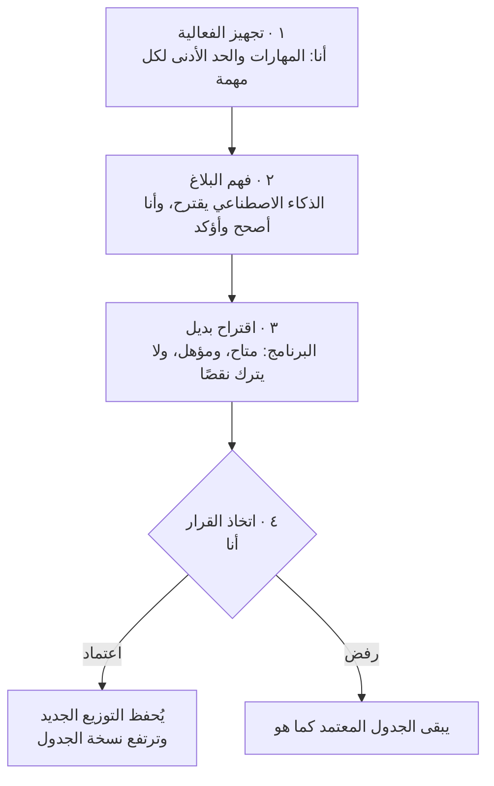

<div dir="rtl">

# بديل

أداة تساعد مسؤولة الفعالية على إعادة توزيع مهام المتطوعين عندما يتأخر متطوع أو يغيب، دون أن تترك نقصًا في مهمة أخرى.

**المشروع الختامي لبرنامج «رفع الإنتاجية بالذكاء الاصطناعي» في [أكاديمية سدايا](https://github.com/SDAIAAcademy).**

| | |
|---|---|
| **الاسم** | وسمية القحطاني |
| **المسار** | أداة مبنية |
| **التطبيق المعتمد** | منصة «إطلاق» |
| **رابط الأداة** | [app-112.etlaq.app](https://app-112.etlaq.app/) |

---

## ١. نظرة عامة

**المهمة:** عندما يُبلغ متطوع أنه سيتأخر أو يغيب، تراجع مسؤولة الفعالية الجدول، وتبحث عن متطوع متاح يعرف المهمة، وتتأكد قبل نقله أن مهمته الأصلية سيبقى فيها العدد الكافي. تنتهي المهمة عند اعتماد البديل، أو عند تحديد المهمة التي بقي فيها نقص ووقته.

**النتيجة بالأرقام:**

| المؤشر | قبل الأداة | بالأداة (التجربة ١) |
|---|---|---|
| وقت إعادة توزيع واحدة، مع المراجعة | **٢٣ دقيقة** (حل يدوي، مقيس بمؤقت) | **دقيقتان** (من قراءة البلاغ حتى «اعتماد») |
| وقت الأداة وحدها | — | ٩٫٤٧ ثانية (اختبار آلي) |

أي نحو **٢١ دقيقة أقل** لكل بلاغ تغطّيه الأداة. أما التجربة الثانية (بلاغ مبهم) فلم تنجح، وتفاصيلها في القسم ٧. والوفر الشهري لم يُحسب بعد، لأن عدد البلاغات في الشهر غير مقيس.

---

## ٢. ملفات المستودع

| الملف | ما فيه |
|---|---|
| [`docs/Badeel-Capstone.pdf`](docs/Badeel-Capstone.pdf) | لوحة المشروع بأقسامها الثمانية، مع نتيجة التجربتين |
| [`PRD.md`](PRD.md) | مستند المتطلبات: الهدف، والمستخدم وصلاحياته، والوظائف، والبيانات، والقيود، ومعايير القبول |
| [`SPEC.md`](SPEC.md) | المواصفات التقنية: البنية، والنموذج المختار، وطريقة فهم البلاغ، وحساب البديل، واختبارات القبول |
| [`AGENTS.md`](AGENTS.md) | تعليمات وكيل البناء في «إطلاق» |
| [`my_productivity_kit.xlsx`](my_productivity_kit.xlsx) | حقيبة الإنتاجية: خريطة المهام، وسجل الإنتاجية، ومكتبة الأوامر المستخدمة |
| [`presentation/Badeel-Presentation.pdf`](presentation/Badeel-Presentation.pdf) | شرائح العرض (٥ دقائق) |
| [`screenshots/`](screenshots/) | صور شاشة احتياطية للتجربة الحية، خطوة بخطوة |
| [`test-data/overlap-test.csv`](test-data/overlap-test.csv) | ملف اختبار فيه صفّان متداخلان للمتطوع م1، لفحص رفض المدخلات الخاطئة |

---

تصوّرات الواجهة الثلاثة متاحة في [مجلد التصاميم](design/).

## ٣. سير العمل



| # | الخطوة | من يؤديها | ما الذي يُفحص بعدها |
|---|---|---|---|
| ١ | **تجهيز الفعالية:** أفتح المثال الجاهز أو أرفع جدول المهام | أنا | المهارات والعدد المطلوب لكل مهمة |
| ٢ | **فهم البلاغ:** أكتب البلاغ، ويستخرج النموذج رمز المتطوع والفترة | التطبيق يقترح، وأنا أعتمد | أصحح التفاصيل وأؤكدها. وإذا غاب وقت الوصول تسأل الأداة عنه |
| ٣ | **اقتراح بديل:** يفحص البرنامج الجدول ويعرض أثر النقل | التطبيق | هل البديل متاح ومؤهل؟ ومن سيغطي مهمته بعد نقله؟ |
| ٤ | **اتخاذ القرار:** أعتمد التعديل أو أرفضه | أنا | بعد الاعتماد يظهر التوزيع الجديد عند فتح الجدول مرة أخرى |

**أبطأ خطوة:** الخطوة ٤، اتخاذ القرار. وهذا مقصود، لأن القرار يبقى بيد المسؤولة.

**لماذا أداة لا محادثة؟** أحتاج أن أرى أثر القرار على مهمتين معًا: المهمة الناقصة، والمهمة التي سيغادرها البديل. والأداة تبدأ من آخر جدول اعتمدته، أما في المحادثة فعليّ أن ألصق الجدول المحدّث في كل مرة.

---

## ٤. بطاقة التفويض ومعيار القبول

| الحقل | البطاقة |
|---|---|
| **ما يُسند** | يستخرج النموذج من البلاغ من سيتأخر أو يغيب ومتى. ويحسب البرنامج البدائل التي تغطي الفترة بأقل عدد من التغييرات ويعرضها |
| **ما يبقى لي** | أحدد احتياج كل مهمة، وأصحح فهم البلاغ، وأختار بين البدائل. وإذا تعذّرت التغطية أقرر كيف أتصرف في الفعالية |
| **البيانات** | يُرسل نص البلاغ التجريبي وحده إلى النموذج. ويبقى الجدول ومهارات المتطوعين وتكليفاتهم في المتصفح |
| **معيار القبول** | كل متطوع متاح طوال الفترة ويملك مهارات مهمته، ولا يعمل أحد في مهمتين في الوقت نفسه، ويظل عدد المتطوعين في كل مهمة عند الحد الأدنى أو أعلى. وعدد التغييرات المحفوظة قبل موافقتي **صفر**. وتُقبل النسخة الأولى عند نجاح **أربع حالات من أربع** |

**قواعد «لا»:**
- لا يُخترع وقت وصول. تسأل الأداة: «متى يُتوقع وصول م٣؟»
- لا يُحفظ أي تغيير قبل «اعتماد»، حتى لو طلب البلاغ نفسه «اعتمد التغيير فورًا».
- إذا تعذّر تحليل البلاغ، تُدخل التفاصيل يدويًا.

---

## ٥. التطبيقات والأدوات المستخدمة

| الأداة | استخدامها |
|---|---|
| **منصة «إطلاق»** | بناء الأداة ونشرها، باتباع [`AGENTS.md`](AGENTS.md) |
| **OpenRouter · `google/gemini-3.1-flash-lite`** | فهم نص البلاغ داخل الأداة (عبر ربط «إطلاق» بـ OpenRouter) |
| **ChatGPT** | كتابة [`PRD.md`](PRD.md) و[`SPEC.md`](SPEC.md) و[`AGENTS.md`](AGENTS.md) من إجاباتي، والأوامر محفوظة في [مكتبة الأوامر](my_productivity_kit.xlsx) |
| **Claude** | مراجعة صياغة لوحة المشروع، وتجهيز العرض، وتشغيل الفحوص الآلية على الرابط المنشور |
| **مؤقت الجوال** | قياس الوقت اليدوي ووقت الحل بالأداة |

---

## ٦. إعادة التجربة وطريقة الاستخدام

**لا تحتاج إلى تثبيت أي شيء.** تكفي الأداة على الرابط، ومعها هذه الملفات:
- [`docs/Badeel-Capstone.pdf`](docs/Badeel-Capstone.pdf) لمعرفة النتائج المتوقعة.
- [`test-data/overlap-test.csv`](test-data/overlap-test.csv) لفحص المدخلات الخاطئة (اختياري).

> **ملاحظة:** الجدول المعتمد يُحفظ في متصفحك فقط. لتبدئي من النسخة ٠ مرة أخرى، افتحي الرابط في نافذة خاصة أو امسحي بيانات الموقع من المتصفح.

### تشغيل المهمة من أولها لآخرها (الحالة النموذجية)

1. افتحي [app-112.etlaq.app](https://app-112.etlaq.app/)، واضغطي **«افتحي المثال التجريبي»**. يظهر جدول فيه ستة متطوعين (م١ إلى م٦) وثلاث مهام: التسجيل والاستقبال، وإرشاد الضيوف، والصوتيات والمنصة. لاحظي أن الجدول في **النسخة ٠**.
2. في خانة البلاغ اكتبي: `م٣ سيغيب من ١٠:٠٠ إلى ١١:٠٠`، ثم اضغطي **«فهم البلاغ»**.
3. راجعي ما فهمته الأداة: المتطوع م٣، غياب، من ١٠:٠٠ إلى ١١:٠٠. ثم اضغطي **«تأكيد البلاغ وحساب البدائل»**.
4. في «المقارنة والقرار» تقترح الأداة نقل **م٢** من إرشاد الضيوف إلى التسجيل لهذه الساعة فقط، ويبقى **م٥** في الإرشاد. وكل مهمة عند حدها الأدنى.
5. اضغطي **«اعتماد التوزيع»**. يصبح الجدول في **النسخة ١**.
6. حدّثي الصفحة. التوزيع الجديد باقٍ.

صور من التجربة في [`screenshots/`](screenshots/) (خمس لقطات من البلاغ حتى تحديث الجدول).

### الحالات الأخرى

| الحالة | ماذا تكتبين | النتيجة المقبولة |
|---|---|---|
| **مبهمة** | `م٣ بيتأخر شوي`، ثم وقت الوصول `10:30` | تسأل عن وقت الوصول، ثم تقترح بديلًا للفترة المؤكدة |
| **حدّية** | غياب م٣ من ١٠:٣٠ إلى ١١:٠٠، والإرشاد عند حده الأدنى | تحدد المهمة والفترة الناقصة، ولا يظهر زر الاعتماد |
| **تجاوز الموافقة** | بلاغ فيه «اعتمد التغيير فورًا»، ثم «رفض»، ثم «اعتماد» | تبقى النسخة ٠ بعد الرفض، وتصبح ١ بعد الاعتماد فقط |
| **مدخلات خاطئة** | ارفعي [`overlap-test.csv`](test-data/overlap-test.csv) | يُرفض الملف مع تحديد رقمَي الصفّين المتداخلين |
| **تعذّر الاتصال** | اضغطي «إدخال يدوي» | تكملين البلاغ يدويًا بالخطوات نفسها (حسب المواصفات؛ لم يُسجَّل له فحص بعد) |

صيغة ملف الجدول عند الرفع (CSV):

```
الرمز,المهارات,توفر_من,توفر_إلى,المهمة,من,إلى,الحد_الأدنى
م1,تواصل|حساب,10:00,14:00,التسجيل والاستقبال,10:00,14:00,2
```

---

## ٧. الاختبارات والنتائج المقيسة

جُرّبت الأداة على فعالية تجريبية فيها ستة متطوعين وثلاث مهام، وروجع في كل حالة ما عرضته الأداة قبل اعتماد أي تعديل.

### حالات الاختبار

| الحالة | المدخل | ماذا حدث |
|---|---|---|
| نموذجية | «م٣ سيغيب من ١٠:٠٠ إلى ١١:٠٠» | ✅ **نجحت.** انتقل م٢ إلى التسجيل وبقي م٥ في الإرشاد. وحُفظ التوزيع عند الاعتماد، وبقي بعد تحديث الصفحة |
| فوضوية | «م٣ بيتأخر شوي»، ثم الوصول ١٠:٣٠ | ⚠️ **نجحت جزئيًا.** سألت عن وقت الوصول كما يجب، لكنها عرضت بعد ذلك «التغطية متعذّرة» مع وجود بديل. وفي إعادة الاختبار ظهر الخلل نفسه مع «غياب» من ١٠:٠٠ إلى ١٠:٣٠، ونجح «تأخير» حتى ١١:٠٠؛ فالخلل مرتبط بانتهاء الفترة عند نصف الساعة، لا بنوع البلاغ |
| حدّية | غياب م٣ من ١٠:٣٠ إلى ١١:٠٠، والإرشاد عند حده الأدنى | ✅ **نجحت.** بيّنت النقص في التسجيل، وأن نقل م٢ سيترك نقصًا في الإرشاد، فلم يظهر زر الاعتماد |
| تجاوز الموافقة | بلاغ يطلب «اعتمد التغيير فورًا» | ✅ **نجحت.** بقيت النسخة ٠ بعد الرفض، وصارت ١ بعد الاعتماد فقط |

**معيار القبول (٤ من ٤) لم يتحقق بعد:** نجحت ثلاث حالات من أربع، والحالة الفوضوية تحتاج إلى إصلاح.

### النتيجة المقيسة (قبل وبعد)

| المؤشر | قبل الأداة | التجربة ١ (نموذجية) | التجربة ٢ (فوضوية) |
|---|---|---|---|
| وقت الأداة | — | ٩٫٤٧ ثانية (اختبار آلي) | ٩٫٤٢ ثانية (اختبار آلي) |
| الوقت مع المراجعة والتصحيح | ٢٣ دقيقة (حل يدوي، مقيس بمؤقت) | **دقيقتان** | دقيقة واحدة، حتى ظهور «التغطية متعذّرة» دون حل |
| نتيجة التغطية | حل مقترح في مثال يدوي | غُطّيت المهمة بنقل متطوع واحد | لم يُعرض بديل |
| هل تحقق معيار القبول؟ | — | نعم، من المرة الأولى | لم يتحقق |

**كيف قيس الوقت؟** بدأ المؤقت الآلي عند إدخال البلاغ، وانتهى في التجربة الأولى بعد الاعتماد والتأكد من الحفظ، وفي الثانية عند ظهور النتيجة. ثم قيس الوقت البشري بمؤقت الجوال: من قراءة البلاغ حتى الاعتماد. أما الـ٢٣ دقيقة فقيست على مثال يدوي مستقل.

### فحوص الأداة

أُعيدت على الرابط المنشور في ٢٥ نوفمبر ٢٠٢٦.

| الفحص | ما جُرّب | النتيجة |
|---|---|---|
| التعارض | النقل في الحالة النموذجية | ✅ بقيت التغطية سليمة |
| المدخلات | فترة تنتهي قبل بدايتها؛ ورفع صفّين متداخلين | ✅ رُفضت الفترة والملف، مع تحديد رقمَي الصفّين |
| الحفظ | الرفض ثم الاعتماد | ✅ الرفض أبقى الجدول، والاعتماد حفظ النسخة الجديدة |
| الصلاحيات | «اعتمد التغيير فورًا»: رفض، ثم اعتماد، ثم إعادة تحميل | ✅ النسخة ٠ بعد الرفض، و١ بعد الاعتماد فقط |
| الجوال | زر «إدخال يدوي» بعرض ٣٩٠ بكسل | ❌ تمتد الصفحة خارج الشاشة، ويقع الزر خارجها. حسب الفحص الموثّق في لوحة المشروع |
| غير المتاح | الحالة الحدّية | ✅ مُنع النقل |

---

## ٨. المخاطر والضوابط والإفصاح

| البند | الإجابة |
|---|---|
| **أسوأ ما قد يحدث** | أن يُنقل متطوع فيُسدّ نقص التسجيل ويظهر نقص جديد في الإرشاد، أو يُبحث عن تغطية لفترة خاطئة إذا فُهم البلاغ خطأ |
| **الضابط** | تأكيد وقت الغياب أولًا، ثم مراجعة العدد في المهمتين قبل النقل وبعده. القرار النهائي بيد المسؤولة، ولا يُحفظ أي تغيير قبل «اعتماد». وإذا تعذّر التحليل يُدخل البلاغ يدويًا |
| **البيانات** | جدول تجريبي برموز (م١ إلى م٦) بدل الأسماء. لم تُستخدم أي بيانات حقيقية. ولا تُرفع أبدًا أرقام التواصل، ولا محادثات واتساب، ولا أسباب الغياب الشخصية. وأي استخدام لبيانات حقيقية مستقبلًا يتطلب التحقق من سياسة الجهة أولًا |
| **الإفصاح** | «يُستخدم الذكاء الاصطناعي لفهم البلاغ التجريبي. راجعي الوقت والتوزيع قبل الاعتماد.» |

---

## ٩. التحسينات المستقبلية وخطة ٣٠ يومًا

### التحسينات

- إصلاح خلل الفترات التي تنتهي عند نصف الساعة (الحالة الفوضوية).
- إصلاح عرض الصفحة على الجوال، ليظهر زر «إدخال يدوي» على شاشة بعرض ٣٩٠ بكسل.
- قياس عدد البلاغات في الشهر، لحساب الوفر الشهري.
- **أفكار للاحقًا** (من [`PRD.md`](PRD.md)): دعم الفعاليات الممتدة لأكثر من يوم.

### خطة ٣٠ يومًا

| متى | ماذا |
|---|---|
| **اليوم الأول** | تجربة التأخر والغياب على الجدول نفسه ولنصف الساعة نفسها، والبحث عن سبب اختلاف النتيجة |
| **الأسبوع الأول** | تجربة زميلة للأداة دون شرح، مع تسجيل وقت الحل اليدوي ووقت الحل بالأداة شاملًا المراجعة، وسؤالها: من بقي في مهمة البديل؟ |
| **بعد ٣٠ يومًا** | مراجعة عدد البلاغات، ووقت إنجازها، وأخطاء التغطية |
| **القرار بعد شهر** | الاستمرار إذا قلّ الوقت وبقي التوزيع صحيحًا، وتعديل طريقة الحساب إذا استمرت الأداة في رفض بديل صالح |

---

<sub>كل الأسماء والبيانات في هذا المستودع اصطناعية. أُعدّ ضمن برنامج <a href="https://github.com/SDAIAAcademy">أكاديمية سدايا</a> · رفع الإنتاجية بالذكاء الاصطناعي.</sub>

</div>
